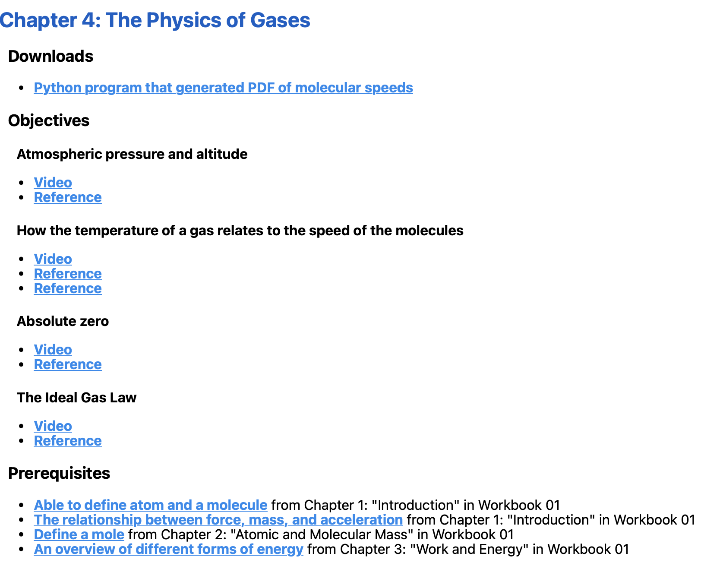

# Digital Resources

You can think of each chapter as made up of several learning objectives. The
sequence, then, is a directed graph: each chapter covers some objectives and
relies upon some prerequisite objectives.

Each of these objectives gets a short unique ID. For example, `atmos` might
represent the objective of having the student understand the idea of atmospheric
pressure.

In addition to an ID, each objective gets:

* A description: "Atmospheric pressure and altitude" (required)
* Some online video links (optional)
* Some online reference links (optional)

Besides a list of objectives that a chapter covers and the list of objectives
that are prerequisites, the chapter can have some files the student can use. For
example, maybe a Python program that the student can download and run.

All of this goes in the chapter's `digital_resources.json`, next to its
`student.tex`. Every chapter needs one.

## `digital_resources.json`

Here is an example of a `digital_resources.json` file for a chapter:

```json
{
  "files": [
    {
      "path": "ar_plot.py",
      "desc": "Python program that generated PDF of molecular speeds"
    }
  ],
  "requires": ["atom", "fma", "mole", "energy-forms"],
  "covers": [
    {
      "id": "atmos",
      "desc": "Atmospheric pressure and altitude",
      "videos": ["https://youtu.be/xJHJsA7bYGc"],
      "references": ["https://en.wikipedia.org/wiki/Atmospheric_pressure"]
    },
    {
      "id": "gas-temp",
      "desc": "How the temperature of a gas relates to the speed of the molecules",
      "videos": ["https://youtu.be/1S9cuYascPQ"],
      "references": ["https://en.wikipedia.org/wiki/Kinetic_theory_of_gases"]
    },
    {
      "id": "ideal-gas-law",
      "desc": "The Ideal Gas Law",
      "videos": ["https://youtu.be/qObcdZj8YTM"],
      "references": ["https://en.wikipedia.org/wiki/Ideal_gas_law"]
    }
  ]
}
```

* `files` lists files in the chapter's directory that the student can download,
  each with a short description. It can be empty.
* `requires` lists the IDs of objectives from *earlier* chapters that this
  chapter depends on.
* `covers` lists the objectives this chapter teaches. Every ID must be unique
  across the whole sequence.

Keep the links useful and durable: a well-known video channel or a stable
reference site such as Wikipedia is better than a page that may disappear. Leave
the tracking parameters (such as `?si=...`) off YouTube links.

## Checking and publishing

These scripts are in the `Build` directory. [`Build/README.rst`](../Build/README.rst)
describes them in detail.

* **`check_ordering.py`** checks that every chapter has a valid
  `digital_resources.json`, that every `requires` ID is covered by some chapter,
  that it is covered *before* the chapter that requires it, and that no ID is
  covered twice. Run it whenever you add a chapter, move chapters between
  workbooks, or edit a `requires` or `covers` list:

  ```sh
  python3 Build/check_ordering.py
  ```

* **`gather_resources.py`** checks every video and reference link and looks up
  each page's title.
* **`build_workbooks_index.py`** turns all of this into `workbooks.json`, which
  the [Kontinua website](https://kontinuafoundation.github.io/) uses to show
  each chapter's resources. Here is how one book's resources looked on an
  earlier version of the site:

  

These run automatically when changes are deployed, so most contributors only
need `check_ordering.py`.

## KontinuaResourceEditor

The structure is simple, but it is a hassle to type by hand. There is a Mac
application that makes it easy to create and edit these files. Here is
[the source](https://github.com/KontinuaFoundation/KontinuaResourceEditor).
